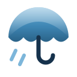
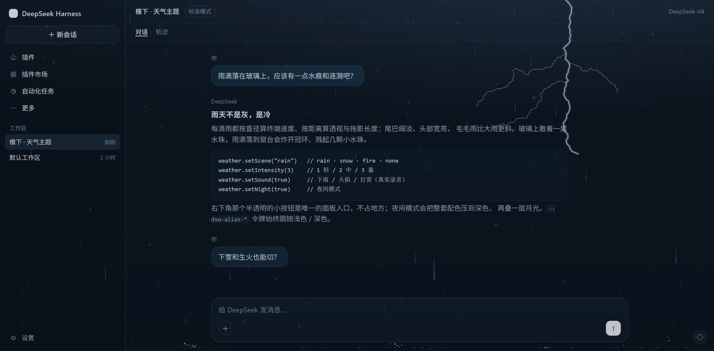
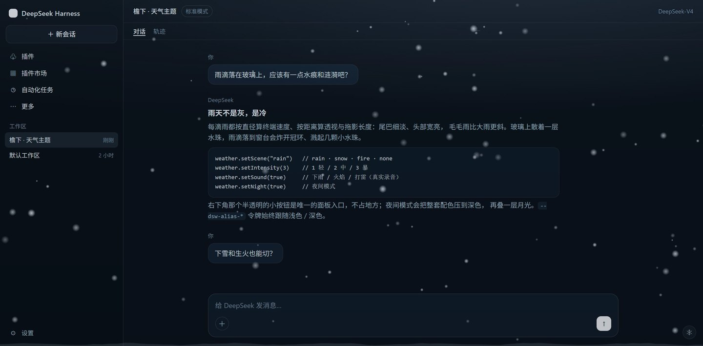
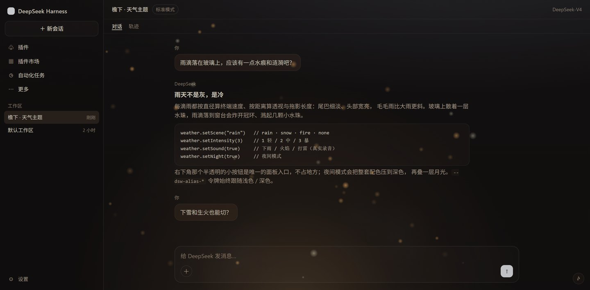

<div align="center">



# Shelter

<p><a href="./README_zh.md">中文</a></p>

<p>
  <a href="https://github.com/ifer47/dsh-theme-shelter/releases"></a>
  <a href="./LICENSE"></a>
  <a href="https://github.com/ifer47/dsh-theme-shelter/stargazers"></a>
  
  
</p>

<p><strong>Immersive weather for DeepSeek Harness</strong> — rain, snow and hearth, with real recordings and a night mode.</p>

</div>

<p align="center">
  
  
  
</p>

**Contents:** [Scenes](#scenes) · [Install](#install) · [Usage](#usage) · [Audio](#audio) · [How it works](#how-it-works) · [Development](#development) · [Release](#release) · [Credits](#credits)

## What it is

Shelter is a thin layer of weather over the DeepSeek Harness web GUI. Rain leaves beads on the glass; snow drifts slowly outside; a fire glows under the composer.

It changes nothing about how DSH works — only the air you sit in while working. The entry point is a 28 px button in the bottom-right corner; the rest of the time it just rains, quietly.

## Scenes

| Scene | What you see | Palette |
| --- | --- | --- |
| **Rain** | Streaks that each fall at their own speed, slant with the wind, and splash where they land | Cool blue-grey, deep navy shadows |
| **Snow** | Two kinds of crystal drifting through one wind field, over a bank that grows as it snows | Colder and whiter, icy-blue accents |
| **Fire** | A warm pulse from below, rising embers, sparks, slow smoke | Warm neutrals, amber accents |

Semantic colors (error red, success green, warning amber) are untouched in every scene.

## Install

Requires DeepSeek Harness (desktop or web).

```powershell
cd "$env:USERPROFILE\.dsh\profiles\desktop"
pnpm add "C:\path\to\dsh-theme-shelter"
```

Then append `dsh-theme-shelter` to `dsh.profile.bundles` in the profile `package.json`, and reload the window (<kbd>Ctrl</kbd>+<kbd>R</kbd>) or restart DSH.

It is also on npm as [`dsh-theme-shelter`](https://www.npmjs.com/package/dsh-theme-shelter): `npm i dsh-theme-shelter` installs the same bundle, and the plugin market installs it from there.

On npm 12+ a tarball or git URL is refused by default (install-time security defaults) — add `--allow-remote` for a remote tarball, or `--allow-git` for a git dependency. This package ships no install scripts, so nothing else is affected.

Manual alternative — add to `~/.dsh/profiles/desktop/cordis.patch.yml`:

```yaml
- insert:
    - id: theme-shelter
      name: dsh-theme-shelter
```

## Usage

Click the small button in the bottom-right corner:

| Control | Effect |
| --- | --- |
| Scene | rain / snow / fire / off |
| Intensity | light / medium / heavy |
| Palette | theme colors on or off — the animation runs either way |
| Lightning | rain only: bolt, flash, thunder |
| Sound | rain and fire recorded, snow wind generated |
| Night | dark palette plus a moonlight wash |

**Lightning.** A strike draws a branched bolt across the sky, flashes the pane, then bangs. The delay encodes distance — 0.3–0.9 s when close, 1.5–2.8 s when far — and a close strike leaves a cracked pane for 5–9 s. Strikes land every 2–9 s, denser at intensity 3.

**Sound.** Browsers refuse audio until the page has seen a click or a keypress, so the first sound arrives after your first interaction.

Settings live in `localStorage["dsh-theme-shelter/v2"]` and survive reloads.

**First run.** On a fresh install a small bubble appears above that button — “点这里切换天气”. It never takes a click itself: any click or keypress anywhere dismisses it, and so does twelve seconds passing. If you miss it, the button is always in the bottom-right corner: 28 px, with a cloud, umbrella, snowflake or flame depending on the scene.

Console API:

```js
__dshWeather.setScene("fire")     // rain · snow · fire · none
__dshWeather.setIntensity(2)      // 1 light / 2 medium / 3 heavy
__dshWeather.setPalette(false)    // animation only, default colors
__dshWeather.setSound(true)
__dshWeather.setNight(false)
__dshWeather.reset()
```

## Audio

Rain and fire are recordings (about 6.7 MB). The host half serves them read-only at `/dsh-theme-shelter/audio/*` with `Range` (206), `HEAD`, a one-year immutable cache, and a 403 for cross-origin `Origin`.

Snow has no recording, because real snowfall is nearly silent: it is a looped brown-noise bed through a lowpass that breathes over roughly fifteen seconds, held at a whisper (0.04 / 0.07 / 0.11 against rain’s 0.18 / 0.30 / 0.42). It needs no asset and starts before any file has loaded.

## How it works

- **Colors** — `ctx.theme.overrideTokens()` overrides 47 `--dsw-alias-*` tokens: surfaces, text, borders, code blocks, scrollbars. Button fills, brand colors, links and focus rings are deliberately left alone.
- **Rain** — every drop carries a diameter and a distance. Terminal velocity is `v = 9.2·√(d/3)` (0.5 mm ≈ 2.2 m/s, 3 mm ≈ 8.5 m/s); screen speed and width scale by `1/z`; the streak is `speed × 6 ms exposure`, clamped to 7–70 px; the angle is `atan(wind / speed)`, so drizzle leans further than heavy rain, over a slow gust envelope. Streaks taper from a thin tail to a bright head and are baked into sprites (5 width × 4 length buckets) so each drop costs one `drawImage`.
- **Splashes** — a landing drop throws 5–9 droplets at 16% of its impact speed (scaled by distance) under 900 px/s² of gravity, plus a crown ring, plus a near-vertical Worthington jet for close, fat drops. Each droplet is an oblate ellipse flattened along its own velocity — and it oscillates while flying, so the flattening breathes; sub-0.5 mm droplets stay round.
- **Snow** — crystals with habits. Two thirds are dendrite aggregates (2.5–7.5 mm, falling at 0.55–1.0 m/s, slow spin, twinkling in the dark) and the rest graupel (1.2–3.5 mm, 1.1–1.7 m/s). Each flake has a depth `z`; screen size is `size × 1800 / z`. They ride a position-coherent wind field (a slow base drift plus turbulence sampled from x, y and time) instead of each flake swaying on its own, and landings deposit mass into an accumulation ridge that grows while it snows instead of appearing pre-formed.
- **Lightning** — a recursive bolt with 1–3 branches, drawn additively over the canvas; the flash and the thunder are scheduled separately so a distant strike flickers first and rumbles seconds later.
- **Audio** — a host-only read route plus `<audio>` on the client for rain and fire, fading out and releasing between scenes, and a Web Audio graph for the snow wind.
- **Cost** — particle counts scale with viewport area and are capped (rain 520, snow 340, fire 64); DPR is capped at 2; rendering pauses in a hidden window; `prefers-reduced-motion` draws a single static frame.

## Development

`preview/preview.html` is a standalone harness: it fakes the module loader and `ctx.theme`, so you can open it directly to see all three scenes, night mode and the panel.

The profile links this package with `link:`, so editing `client/client.js` only needs a DSH restart.

## Release

Three things have to agree: the git tag, `package.json`, and npm. The market reads the GitHub entry and maps it to the npm package by its `repository` field — when the tag and the npm version drift apart, users are told an update exists and then install the old code.

1. **Bump the version in two places** — `version` in `package.json` **and** `const VERSION` in `client/client.js` (the panel footer shows that one). Changing only one leaves the panel reporting the previous release.
2. **Commit, tag, push:**
   ```powershell
   git commit -am "chore: release 0.3.1"
   git tag -a v0.3.1 -m "0.3.1"
   git push --follow-tags
   ```
3. **Publish to npm.** `publishConfig` already points at the origin registry, so no `--registry` is needed even when the machine-level `.npmrc` uses a China mirror:
   ```powershell
   npm publish
   ```

Nothing else to upload by hand: the `tarball:` in the market entry points at a GitHub Release asset and only covers installs that cannot reach npm.

## Known limitations

- Night mode does not write your appearance preference, so Settings still shows the light/dark you picked;
- The overlay sits above the whole window, so dialogs and menus collect rain too (at very low opacity);
- Product icons are not replaceable — that needs a registered theme;
- The rain and fire recordings come from Pixabay (see Credits); the snow wind is generated, so there is nothing to credit there.

## Credits

The ambience recordings come from **[Pixabay](https://pixabay.com/)** and are used under the [Pixabay Content License](https://pixabay.com/service/license-summary/): free for commercial and non-commercial use, no attribution required, but the files may not be redistributed as standalone assets. They are bundled here as part of a larger work.

| File | Use |
| --- | --- |
| `audio/rain.mp3` | rain loop |
| `audio/fire.mp3` | hearth loop |
| `audio/thunder.mp3` | one-shot thunder after a flash |

Drop a replacement with the same filename into `audio/` to swap a sound.

## License

MIT © ifer47
