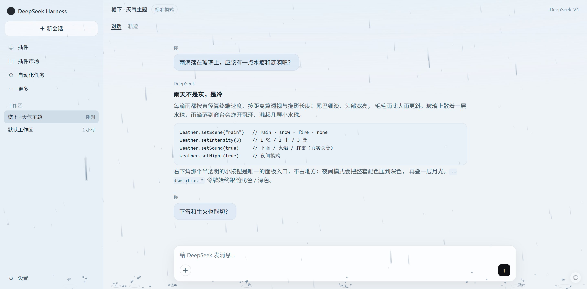
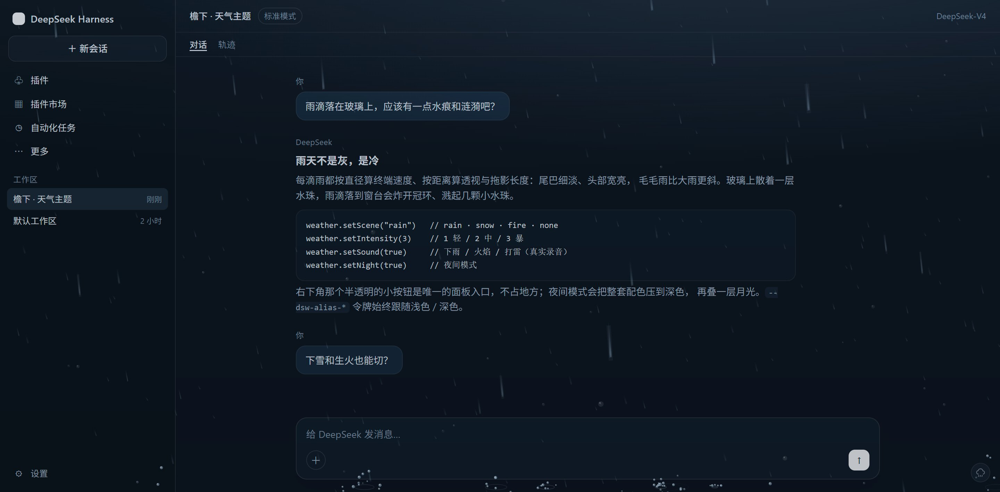
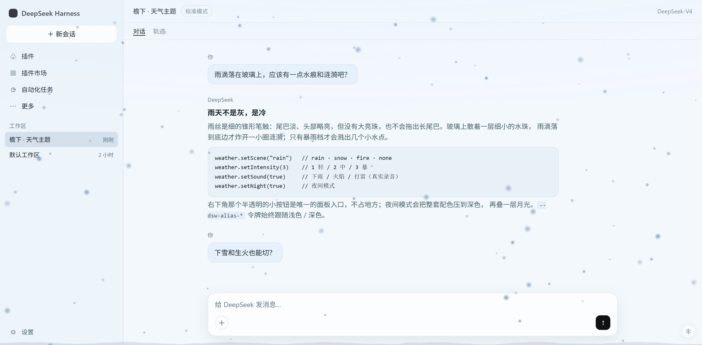
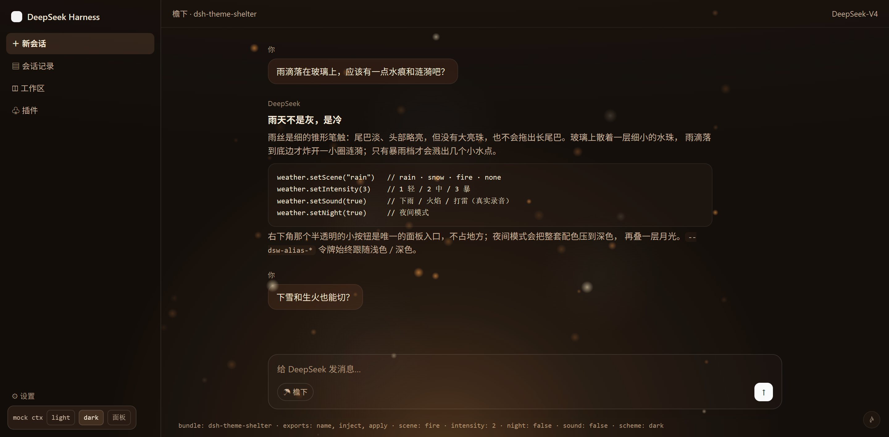
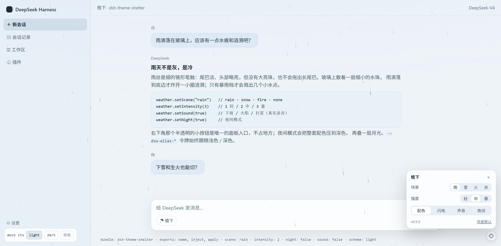

<div align="center">


# Shelter

<p><a href="./README_zh.md">中文</a></p>

<p>
  <a href="https://github.com/ifer47/dsh-theme-shelter/releases"></a>
  <a href="./LICENSE"></a>
  <a href="https://github.com/ifer47/dsh-theme-shelter/stargazers"></a>
  
  
</p>

<p><strong>Immersive weather for DeepSeek Harness</strong> — rain, snow and hearth, with real recordings and a night mode.</p>

</div>

<p align="center">
  
</p>

<p align="center">
  
  
</p>

<p align="center">
  
  
</p>

**Contents:** [Install](#install) · [Usage](#usage) · [Audio](#audio) · [How it works](#how-it-works) · [Development](#development) · [Credits](#credits)

## What it is

Shelter is a thin layer of weather over the DeepSeek Harness web GUI. Rain leaves beads on the glass; snow drifts slowly outside; a fire glows under the composer.

It changes nothing about how DSH works — only the air you sit in while working. The entry point is a 28 px button in the bottom-right corner; the rest of the time it just rains, quietly.

## Scenes

| Scene | What you see | Palette |
| --- | --- | --- |
| **Rain** | Every streak is computed, not drawn: terminal velocity from the drop's diameter (`v ∝ √d`), speed and width from perspective (`1/z`), length from the shutter (`speed × exposure`). Thin and faint at the tail, widest at the head; drizzle slants further in wind than heavy rain; splashes and crown rings where drops land | Cool blue-grey, deep navy shadows |
| **Snow** | Slow flakes, six-armed crystals up close, occasional glints, a soft bank at the bottom | Colder and whiter, icy-blue accents |
| **Fire** | A warm pulse from below, rising embers, sparks, slow smoke | Warm neutrals, amber accents |

Semantic colors (error red, success green, warning amber) are untouched in every scene.

## Install

Requires DeepSeek Harness (desktop or web).

```powershell
cd "$env:USERPROFILE\.dsh\profiles\desktop"
pnpm add "C:\path\to\dsh-theme-shelter"
```

Then append `dsh-theme-shelter` to `dsh.profile.bundles` in the profile `package.json`, and reload the window (<kbd>Ctrl</kbd>+<kbd>R</kbd>) or restart DSH.

Manual alternative — add to `~/.dsh/profiles/desktop/cordis.patch.yml`:

```yaml
- insert:
    - id: theme-shelter
      name: dsh-theme-shelter
```

## Usage

Click the small button in the bottom-right corner:

| Control | Effect |
| --- | --- |
| Scene | rain / snow / fire / off |
| Intensity | light / medium / heavy |
| Palette | master switch for the theme colors; the animation keeps running |
| Lightning | rain only, every 7–22 s, with thunder |
| Sound | real recordings; browsers require one gesture first |
| Night | forces the dark palette plus a moonlight wash |

Settings live in `localStorage["dsh-theme-shelter/v2"]` and survive reloads.

Console API:

```js
__dshWeather.setScene("fire")     // rain · snow · fire · none
__dshWeather.setIntensity(2)      // 1 light / 2 medium / 3 heavy
__dshWeather.setPalette(false)    // animation only, default colors
__dshWeather.setSound(true)
__dshWeather.setNight(false)
__dshWeather.reset()
```

## Audio

Three recordings (about 7.7 MB). The host half serves them read-only at `/dsh-theme-shelter/audio/*` with `Range` (206), `HEAD`, a one-year immutable cache, and a 403 for cross-origin `Origin`. Snow reuses the rain loop at a lower volume.

## How it works

- **Colors** — `ctx.theme.overrideTokens()` overrides 47 `--dsw-alias-*` tokens: surfaces, text, borders, code blocks, scrollbars. Button fills, brand colors, links and focus rings are deliberately left alone.
- **Rain** — every drop carries a diameter and a distance. Terminal velocity is `v = 9.2·√(d/3)` (0.5 mm ≈ 2.2 m/s, 3 mm ≈ 8.5 m/s); screen speed and width scale by `1/z`; the streak is `speed × 6 ms exposure`, clamped to 7–70 px; the angle is `atan(wind / speed)`, so drizzle leans further than heavy rain, over a slow gust envelope. Streaks taper from a thin tail to a bright head and are baked into sprites (5 width × 4 length buckets) so each drop costs one `drawImage`.
- **Splashes** — a landing drop throws 5–9 droplets at 16% of its impact speed (scaled by distance) under 900 px/s² of gravity, plus a crown ring, plus a near-vertical Worthington jet for close, fat drops.
- **Snow and fire** — their own particle systems, drawn from pre-rendered sprites.
- **Audio** — a host-only read route plus `<audio>` on the client, fading out and releasing between scenes.
- **Cost** — particle counts scale with viewport area and are capped (rain 520, snow 340, fire 64); DPR is capped at 2; rendering pauses in a hidden window; `prefers-reduced-motion` draws a single static frame.

## Development

`preview/preview.html` is a standalone harness: it fakes the module loader and `ctx.theme`, so you can open it directly to see all three scenes, night mode and the panel.

The profile links this package with `link:`, so editing `client/client.js` only needs a DSH restart.

## Known limitations

- Night mode does not write your appearance preference, so Settings still shows the light/dark you picked;
- The overlay sits above the whole window, so dialogs and menus collect rain too (at very low opacity);
- Product icons are not replaceable — that needs a registered theme;
- Audio comes from Pixabay (see Credits); keep the source note when you reuse it.

## Credits

The ambience recordings come from **[Pixabay](https://pixabay.com/)** and are used under the [Pixabay Content License](https://pixabay.com/service/license-summary/): free for commercial and non-commercial use, no attribution required, but the files may not be redistributed as standalone assets. They are bundled here as part of a larger work.

| File | Use |
| --- | --- |
| `audio/rain.mp3` | rain loop (reused for snow at a lower volume) |
| `audio/fire.mp3` | hearth loop |
| `audio/thunder.mp3` | one-shot thunder after a flash |

Drop a replacement with the same filename into `audio/` to swap a sound.

## License

MIT © ifer47
