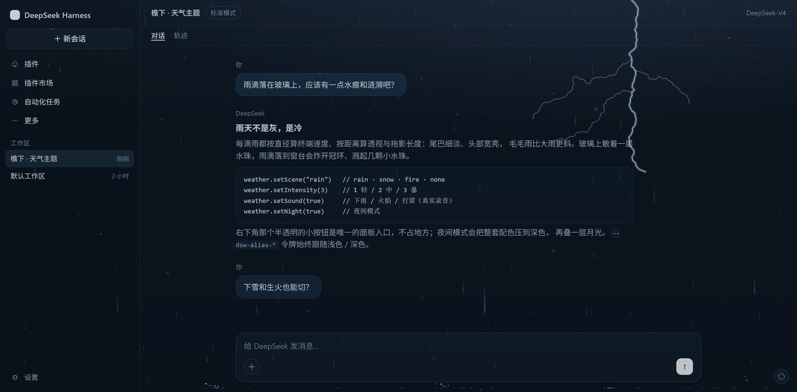
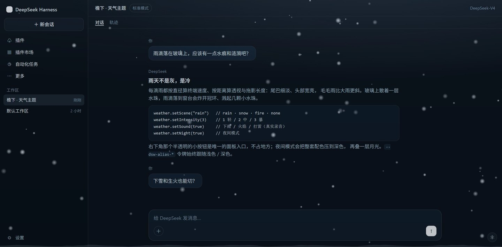
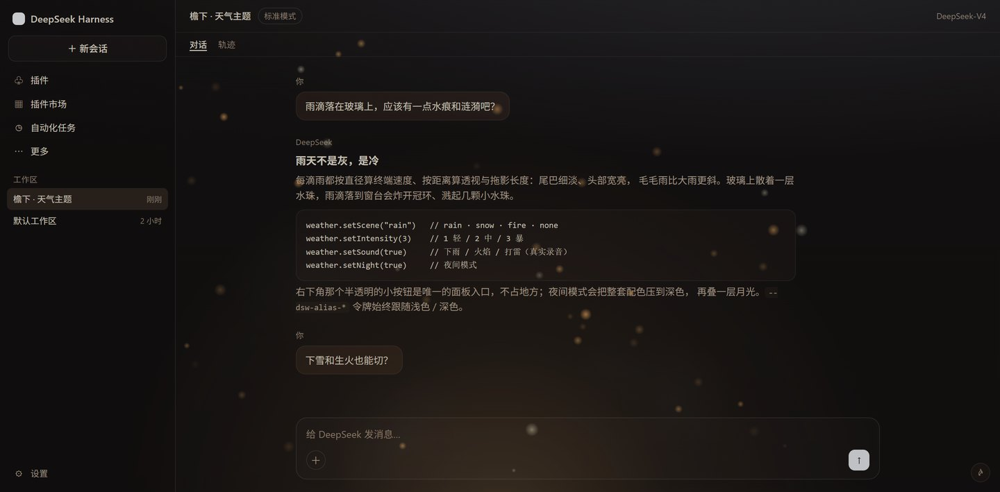
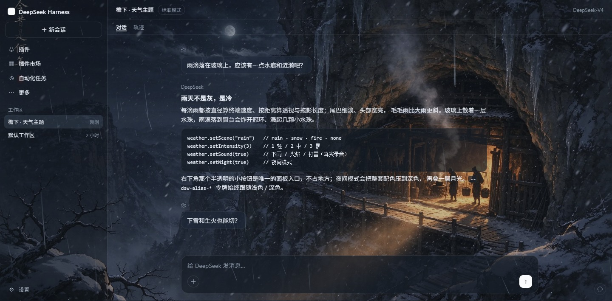
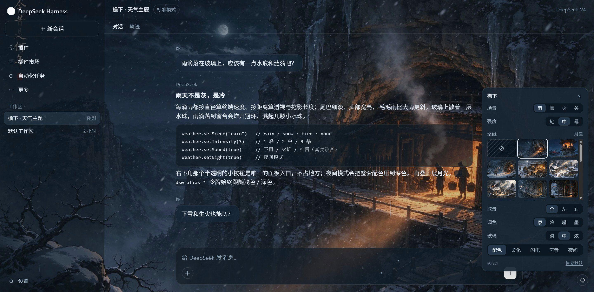

<div align="center">


# 檐下 · Shelter

<p><a href="./README.md">English</a></p>

<p>
  <a href="https://github.com/ifer47/dsh-theme-shelter/releases"></a>
  <a href="https://www.npmjs.com/package/dsh-theme-shelter"></a>
  <a href="https://www.npmjs.com/package/dsh-theme-shelter"></a>
  <a href="./LICENSE"></a>
  <a href="https://github.com/ifer47/dsh-theme-shelter/stargazers"></a>
  
  
</p>

<p><strong>给 DeepSeek Harness 的一层天气</strong>：雨、雪、炉火，窗外还有一幅画，配真实录音与夜间模式。</p>

</div>

<p align="center">
  
  
  
  
</p>

**目录：** [三种场景](#三种场景) · [壁纸](#壁纸) · [安装](#安装) · [使用](#使用) · [声音](#声音) · [工作原理](#工作原理) · [本地开发](#本地开发) · [发布](#发布) · [素材来源](#素材来源)

## 它是什么

檐下是一层很薄的天气。下雨时玻璃上会落水珠、拖出雨丝；下雪时楼外安静地飘；生火时屏幕底部有暖光和上浮的火星。所有这些后面可以挂上一幅画——雪夜山崖上一间亮着灯火的石屋、火线对面的望楼——而整个界面会变成一层玻璃。

它不改 DSH 的任何功能，只改你工作时坐在里面的那点空气。入口只有右下角一颗 28px 的小按钮，其余时间它只是安静地下雨。

## 三种场景

| 场景 | 画面 | 配色 |
| --- | --- | --- |
| **雨** | 每根雨丝速度不同、随风倾斜，落地会溅开 | 冷蓝灰，暗部压到深海蓝 |
| **雪** | 两种晶型穿过同一个风场，底边的积雪随落雪长高 | 更冷更白，强调色偏冰蓝 |
| **火** | 底部暖光与脉动、上浮的火星、迸溅的火星子、缓慢上升的烟 | 暖中性：米白背景、深棕文字、琥珀强调 |

语义色（错误红 / 成功绿 / 警告黄）三种场景都不动，红还是红。

## 壁纸

二十五张各不相同的壁纸。四张是主视觉画作；十八张是同一个世界里的故事系列——山寨的清晨、恶劣天气里的避难所、隐居的山谷、傍晚的瓜棚；另外三张由 `tools/make-wallpapers.py` 程序化绘制。

| 主视觉 | 画面 |
| --- | --- |
| **月崖** | 默认的那幅画：崖下亮着灯的门洞，月亮挂在雪线上 |
| **望楼** | 灯笼照亮的木楼，远山上的火光 |
| **归途** | 老人踩着脚印走向亮灯的洞口 |
| **村雪** | 雪里的茅屋院子、暖窗、栅栏边的狗 |

**故事系列（18）**：晨寨（天光初照的山寨）· 炊烟（同一座山寨，屋顶升起炊烟）· 雪阶（凿在崖壁上的雪阶）· 火塘（洞屋里的火塘，门开着对着雪）· 夜渡（风暴里的一叶小船）· 泊岸（停在水阁下的船）· 洞宴（岩洞里的长桌宴）· 桃源（桃花山谷）· 花溪（同一片山谷，桃花在前）· 崖居（崖壁上的住处）· 雪径（雪里的两个人影）· 围炉（洞中两人对火）· 洞楼（凿进山洞的木楼）· 洞天（碧潭边的饭桌）· 水帘（瀑布后面的碧潭）· 暖潭（暖光里的水潭与花枝）· 藤居（瓜田里的木屋）· 夏院（夏夜小院，西瓜与猫）。

**程序化绘制（3）**：夜林（雾中树林）· 檐雨（湿玻璃与光斑）· 极光（极光帘幕）。

选择器是三列缩略图，超过三行后在面板内滚动；打开面板时会把当前壁纸滚进视野。

**取景**与**调色**是独立于图片的，所以任何一张壁纸（包括你自己的图）都能重新裁切、重新上色：

| 控件 | 作用 |
| --- | --- |
| **取景** | 全 / 左 / 右——两侧取景向对应边缘放大 1.5 倍，宽画也能换一个构图 |
| **调色** | 原 / 冷 / 暖 / 墨——冷调、暖棕、黑白 |
| **玻璃** | 淡 / 中 / 浓——画面被压暗多少；卡片和输入框始终足够实，保证可读 |
| **柔化** | 只虚化画面，界面本身的对比度不变 |

<p align="center">
  
</p>

**换成自己的图。** 点面板里的 `＋` 选一张，或者把图片直接拖进面板。图片会被限制在 2560×1600 以内，能省字节时重新编码为 WebP，存进 IndexedDB——刷新还在，而且不出浏览器。再点一次这块缩略图即可更换，选中时右上角的 `×` 删除。

**一个壁纸文件夹。** 把图片放进 `~/.dsh/wallpapers/`（改过 DSH home 就是 `$DSH_HOME/wallpapers/`），下次打开面板就会多出对应的缩略图（PNG / JPEG / WebP / AVIF / GIF，插件对那个目录只读）。

**玻璃。** 壁纸得先透得出来。有壁纸时，插件把「页面底色」这一个令牌彻底变透明——外壳会在 `body`、外框和标签容器上各画一次它，只要留一点不透明度就会叠成三层、糊成一片——然后只在画面上铺一层带色调的薄纱，同时让卡片、菜单、输入框保持接近实心。这样画面是清晰、足量的，文字也有落脚的地方。面板其余部分和以前一样。

## 安装

需要 DeepSeek Harness（桌面端或 Web 端均可）。

```powershell
cd "$env:USERPROFILE\.dsh\profiles\desktop"
pnpm add "C:\path\to\dsh-theme-shelter"
```

再把它加到 profile `package.json` 的 `dsh.profile.bundles` 末尾，然后刷新窗口（<kbd>Ctrl</kbd>+<kbd>R</kbd>）或重启 DSH。

它也发布在 npm 上：[`dsh-theme-shelter`](https://www.npmjs.com/package/dsh-theme-shelter)。`npm i dsh-theme-shelter` 装的是同一个包，插件市场也会优先从 npm 安装。

npm 12 起默认不允许从远程 tarball 或 git 地址安装（安装时安全默认值）：装远程 tarball 加 `--allow-remote`，git 依赖加 `--allow-git`。本包没有任何安装脚本，其余不受影响。

也可以手动挂载——在 `~/.dsh/profiles/desktop/cordis.patch.yml` 末尾追加：

```yaml
- insert:
    - id: theme-shelter
      name: dsh-theme-shelter
```

## 使用

点右下角的小按钮打开面板：

<p align="center">
  
</p>

| 控件 | 作用 |
| --- | --- |
| 场景 | 雨 / 雪 / 火 / 关（关 = 撤掉配色和画面） |
| 强度 | 轻 / 中 / 暴：粒子密度、雨量、积雪高度、火势 |
| 壁纸 | 无 · 25 张内置壁纸 · 自定义图片；`~/.dsh/wallpapers` 里的文件也会列出来 |
| 取景 | 全 / 左 / 右：裁切并放大当前壁纸 |
| 调色 | 原 / 冷 / 暖 / 墨：给画面重新上色 |
| 玻璃 | 淡 / 中 / 浓：薄纱把画面压暗多少 |
| 柔化 | 虚化画面，界面本身保持清晰 |
| 配色 | 调色板总开关；关掉只留动画与中性玻璃 |
| 闪电 | 只在雨天有效：闪电、闪光、雷声 |
| 声音 | 雨、火为录音，雪为程序化风声 |
| 夜间 | 强制深色配色 + 月光覆层 |

**关于闪电。** 一次雷击会划出一道分叉的闪电、闪一下、再响一声。雷声延迟代表距离——近处 0.3–0.9 秒，远处 1.5–2.8 秒；近雷还会在玻璃上留下 5–9 秒的裂纹。大约每 2–9 秒一次，强度越高越密。

**关于声音。** 浏览器要求页面先收到一次点击或按键才放行音频，所以第一声要等你先动一下。

设置存在 `localStorage["dsh-theme-shelter/v2"]`，刷新、重启都保留；只有自定义壁纸那张图存在 IndexedDB 里，因为照片放不进 5 MB 的配额。

**首次使用。** 全新安装后，按钮上方会浮出一个小气泡「点这里切换天气」。它自己不接收点击——你在任意位置点一下或按任意键，它就会消失，等 12 秒也一样。错过了也不影响使用：按钮永远在窗口右下角，28px，图标随场景变成云 / 伞 / 雪花 / 火焰。

控制台也可以直接调：

```js
__dshWeather.setScene("fire")     // rain · snow · fire · none
__dshWeather.setIntensity(2)      // 1 轻 / 2 中 / 3 暴
__dshWeather.setPalette(false)    // 只用动画，不改配色
__dshWeather.setWallpaper("tower") // 任意 __dshWeather.wallpapers 里的 id，或 none / custom / "u:<文件>"
__dshWeather.setWallCrop("left")  // full · left · right
__dshWeather.setWallTone("warm")  // none · cool · warm · ink
__dshWeather.setWallDepth(3)      // 1 淡 / 2 中 / 3 浓
__dshWeather.setWallBlur(true)    // 虚化画面
__dshWeather.setSound(true)
__dshWeather.setNight(false)
__dshWeather.reset()
```

## 声音

雨和火是真实录音（`audio/`，约 6.7 MB）。宿主半边注册只读路由 `/dsh-theme-shelter/audio/*` 交给浏览器，支持 `Range`（206）、`HEAD`、一年缓存，外站 `Origin` 返回 403。

雪没有录音，因为真实的雪几乎是无声的：它是一段 loop 的棕噪声，过一个约十五秒呼吸一次的低通，音量压到耳语级（0.04 / 0.07 / 0.11，雨是 0.18 / 0.30 / 0.42）。不需要任何素材，录音还没加载完就能响。

## 工作原理

- **配色**：`ctx.theme.overrideTokens()` 覆盖 47 个 `--dsw-alias-*` 令牌，只碰表面、文字、边框、代码块、滚动条；按钮填充、品牌色、链接、焦点环一律不动。
- **壁纸**：一个固定在 `z-index: -1` 的图层——在所有表面之下，在 `body` 背景「上递」到的那块画布之上。里面两层负责交叉淡入，第三层铺色调。取景是一个 `transform`（放大 1.5 倍、锚点落在画面外侧一点，虚化也不会露出边缝），调色是一层 filter，两者都不需要额外素材。内置壁纸由宿主提供，自定义图是 IndexedDB 里的 blob 转成的 object URL。
- **玻璃**：外壳会同时在 `body`、外框和标签容器上画 `--dsw-alias-bg-base`，所以这个令牌只要留一点不透明度就会叠三次、把画面糊成一片。壁纸模式因此把这一个令牌彻底透明化，再把其余表面分成 `page` / `panel` / `content` 三档（浅色默认档约 0.44 / 0.84 / 0.78，深色略低）。对比度交给画面上的那一层薄纱：浅色 0.34、深色 0.24；同时关掉「水汽」——它叠在界面之上，有壁纸时只会把字洗淡。文字、边框、交互色仍然完全不透明。
- **雨**：每滴雨带一个直径和距离。终端速度 `v = 9.2·√(d/3)`（0.5mm≈2.2m/s，3mm≈8.5m/s）；屏幕速度与宽度乘 `1/z` 透视；拖影长度 `= 速度 × 6ms 曝光`，夹在 7–70px；倾角 `atan(风/速度)`，所以毛毛雨比大雨更斜，再叠一层慢速阵风。雨丝形状是「尾细淡、头宽亮」的锥度，按 5 个宽度档 × 4 个长度档预烘焙成贴图，每帧一次 `drawImage`。
- **水花**：雨滴落到窗台时，以落速的 16%（按距离衰减）抛出 5–9 颗小水珠，重力 900 px/s²；另有一个椭圆冠环，近处较大的雨滴还会补一发几乎垂直的中心水柱。水珠不是圆的——它被画成**沿自身飞行方向压扁的椭圆**，飞行中还会振荡变形（0.5mm 以下的小水珠保持球形，表面张力占主导）。
- **雪**：带「晶型」的雪片。约三分之二是树枝状聚合（2.5–7.5 mm，0.55–1.0 m/s，缓慢自转，深色下会闪光），其余是霰（1.2–3.5 mm，1.1–1.7 m/s）。每片雪带一个深度 `z`，屏幕尺寸 `= 尺寸 × 1800 / z`；它们跟着一个**位置相干的风场**走（缓慢的基础风 + 由位置和时间采样的湍流），而不是各自摆动；落地会按质量累积到地面的雪脊上，雪脊是慢慢长出来的，不是一开始就有。
- **闪电**：递归生成的锯齿闪电，带 1–3 条分叉，用叠加混合画在画布上；闪光和雷声分开调度，所以远处的雷会先闪、过几秒再响。
- **音频**：雨和火走宿主只读路由 + 客户端 `<audio>`，切换场景时淡出并释放；雪风走一个 Web Audio 图。
- **宿主路由**：只读前缀 `/dsh-theme-shelter`，下挂 `audio/`、内置 `wallpapers/`、用户目录 `wallpapers/u/<文件>` 和一份 `wallpapers/list.json` 清单。内置壁纸只要文件名是规规矩矩的 `<slug>.webp`、且该文件确实在 `wallpapers/` 里就提供，所以加图不用再维护第二份清单；用户分支只接受「单个文件名 + 图片后缀」，取用前再校验一次是否越出目录，并带 `X-Content-Type-Options: nosniff`。
- **开销**：粒子数按视口面积计算并夹上限（雨 520、雪 340、火 64），DPR 上限 2，切后台停表，`prefers-reduced-motion` 只画一帧静止画面、并跳过壁纸淡入。每张壁纸只解码一次（WebP，最宽 2560，50–512 KB），面板缩略图是另外的 2–21 KB 小图，选图时只解码缩略图；不显示的图层会卸掉 filter，不再常驻第三块离屏缓冲。

## 本地开发

`preview/preview.html` 是一个不依赖 DSH 的预览壳：伪造模块加载器、`ctx.theme` 和素材根路径，双击即可看三种场景、夜间、全部壁纸、取景调色与面板。它也能验证自定义壁纸——往里拖一张图，和真实 GUI 一样会存进 IndexedDB。

profile 里是 `link:` 依赖，改完 `client/client.js` 只需重启 DSH。三张绘制壁纸用 `python tools/make-wallpapers.py wallpapers` 重新生成（脚本里带固定种子，结果可复现），画作单独转成 WebP 与缩略图。加一张内置壁纸＝往 `wallpapers/` 放 `<id>.webp` 和 `<id>-thumb.webp`，再在 `client/client.js` 的 `WALLPAPERS` 里登记一行——宿主会直接提供该目录下所有 `<slug>.webp`，不需要第二份清单。

## 发布

三样东西必须对齐：git tag、`package.json`、npm。市场读的是 GitHub 上的条目，再靠 `repository` 字段把 npm 包映射过来——tag 和 npm 版本一旦漂移，用户会被提示“有新版本”，装到的却是旧代码。

1. **两个地方一起改版本号** —— `package.json` 的 `version` **和** `client/client.js` 里的 `const VERSION`（面板页脚显示的是后者）。只改一处，面板会一直报上一个版本。
2. **提交、打 tag、推送：**
   ```powershell
   git commit -am "chore: release 0.7.1"
   git tag -a v0.7.1 -m "0.7.1"
   git push --follow-tags
   ```
3. **发到 npm。** `publishConfig` 已经把发布目标钉在官方源，所以即使机器级的 `.npmrc` 用的是国内镜像，也不需要加 `--registry`：
   ```powershell
   npm publish
   ```

条目里的 `tarball:` 指向 GitHub Release 上的预构建包，那是独立的一条兜底路径，只在 npm 不可达时才用得上——平时不需要手动上传。

**npm 是唯一的发布源。** GitHub 仓库右侧的 Packages 面板会一直是空的：那里只列 GitHub Packages 上的包，而本包没有往 `npm.pkg.github.com` 发布。要填满它就只能加 scope 另发一份 `@ifer47/dsh-theme-shelter`，同一份代码多出一个包名，只会让用户多问一句"到底装哪个"。装 npm 上的 `dsh-theme-shelter`，或者直接从插件市场装即可。

## 已知限制

- 夜间模式不写你的外观偏好，所以设置页仍显示你原来选的浅色/深色；
- 覆盖层叠在整个窗口上，模态框、菜单上面也会落雨落雪（透明度很低）；
- 玻璃只对用 `--dsw-*` 令牌绘制的表面生效；某个组件如果写死了背景色，它会盖在壁纸上面；
- 自定义图片属于当前浏览器配置（IndexedDB），不会同步到别的浏览器或另一台机器——想跟着机器走，就把图放进 `~/.dsh/wallpapers/`；
- 壁纸是背景，不是模糊：调「玻璃」是在画面和可读性之间换。画面很杂时，浅色主题要选「浓」才能让长段正文保持足够对比度；
- 25 张里 3 张是程序化绘制的插画，不是画作；想换成别的图，直接往 `wallpapers/` 里放；
- 不改产品图标（那需要注册独立主题）；
- 雨声和火声来自 Pixabay（见素材来源）；雪风是程序生成的，不涉及素材授权。

## 素材来源

随包发布二十二张画作——「今昔是何年」「庇护所」「雪天山洞荒山老人」「古风冬雪树屋」以及十八张的故事系列——都以 WebP 放在 `wallpapers/` 下，这样全新安装就有一墙画可挑。另外三张（`forest` / `rain` / `aurora`）由本仓库的 `tools/make-wallpapers.py` 生成，不涉及第三方授权。

声音素材来自 **[Pixabay](https://pixabay.com/)**，按 [Pixabay Content License](https://pixabay.com/service/license-summary/) 免费使用：可用于商业与非商业作品、无需署名，但不允许把素材**原样单独再分发**。这里是作为插件的一部分打包，属于「用于更大的作品」。

| 文件 | 用途 |
| --- | --- |
| `audio/rain.mp3` | 雨声循环 |
| `audio/fire.mp3` | 炉火循环 |
| `audio/thunder.mp3` | 闪电后的一次性雷声 |

想换音色，直接放同名文件进 `audio/` 即可。

## License

MIT © ifer47
